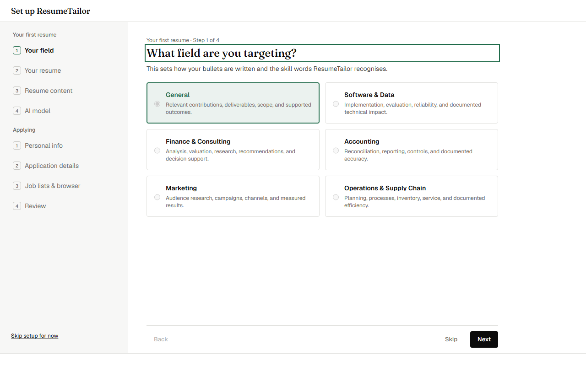
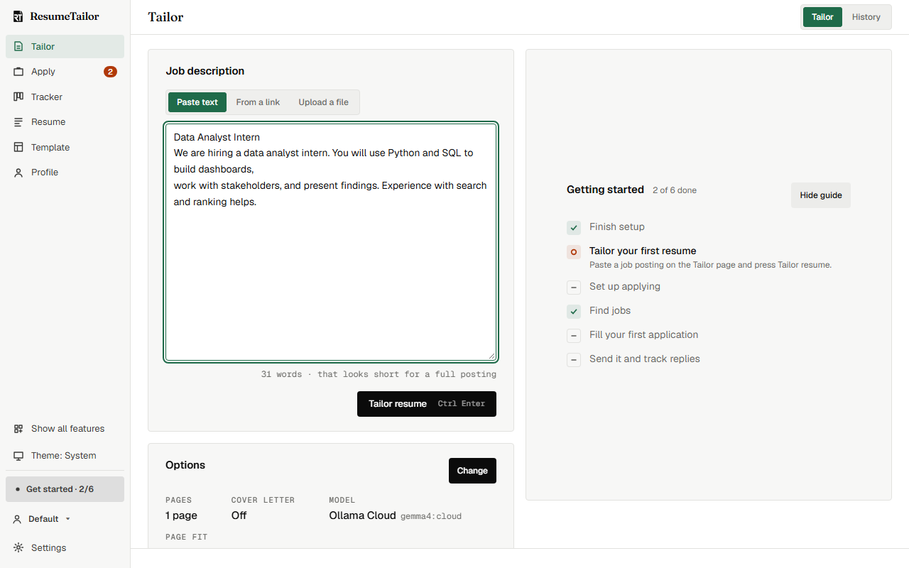
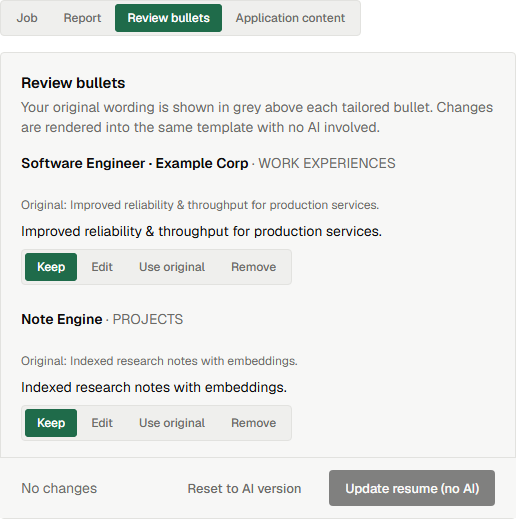
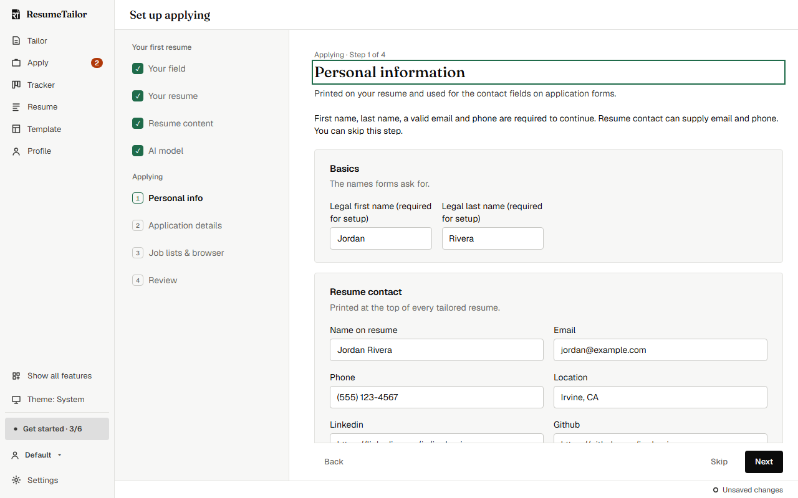
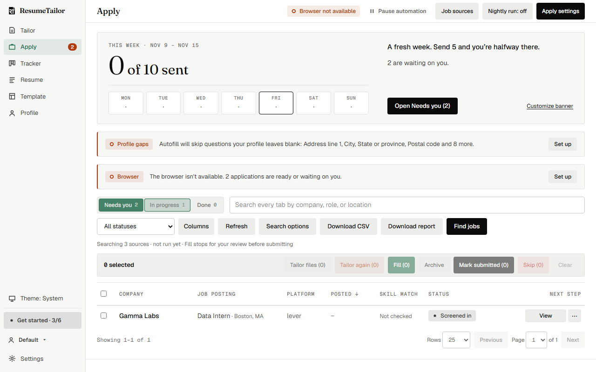
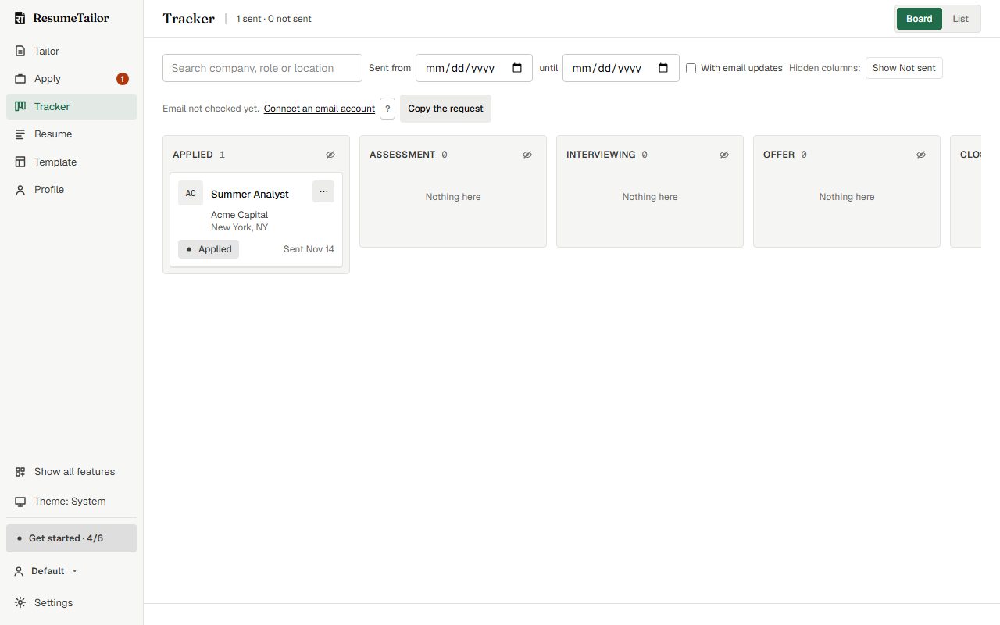

# ResumeTailor quick start

ResumeTailor rewrites your resume for each job you apply to. Your layout, fonts and spacing
stay exactly the same; only the words change, and only using things that are already in
your resume. It never makes up experience.

You need: your resume as a Word file (`.docx`), and about 15 minutes. Whoever set up the
app for you has already connected the AI model, so you do not need an API key.

The app keeps a **Getting started** checklist in the left sidebar and on the Tailor page.
It ticks each step off by itself as you go, and its button always takes you to the next
one. This page walks through the same six steps.

---

## 1. Set up your first resume

The first time you open the app, it asks four things:

1. **Your field.** Pick the kind of job you are going for. This changes how bullets are
   worded and which skills the app recognises.
2. **Your resume.** Upload your `.docx` resume. The app copies its design so tailored
   versions look identical, and reads in your jobs, projects and bullet points.
3. **Resume content.** Check what was read in. Fix anything that came through wrong, and
   make sure your name and contact details at the top are right.
4. **AI model.** This should already show a working model. If it shows an error, ask the
   person who set up the app for you.

Press **Next** on each step. After the fourth, the full app opens.

## 2. Tailor your first resume

1. Copy a job posting from any job site.
2. On the **Tailor** page, paste it into the big box, or use **From a link**.
3. Press **Tailor resume**. It takes a minute or two.

When it finishes, your tailored resume appears on the right. Open **Review bullets** to
compare each new bullet with your original wording. For each one you can **Keep** it,
**Edit** it yourself, go back to your **original**, or **Remove** it. Press
**Update resume (no AI)** to apply your changes, then **Download PDF**.

> Read every bullet before you send a resume. The app only uses facts from your own
> resume, but you are the one who knows what is accurate.

## 3. Set up applying

The app can also find jobs and fill in application forms for you. Press **Set up
applying** in the Getting started checklist. It asks:

- **Personal info**: your legal name, email and phone, as forms ask for them.
- **Application details**: questions most forms ask, such as work authorisation,
  graduation date and location. Anything you leave blank, the app asks you about when a
  form needs it.
- **Job lists & browser**: which job lists to search, and which browser should open to
  fill in forms.

You can skip any of these and come back later from the **Profile** page.

## 4. Find jobs

On the **Apply** page, press **Find jobs**. The app searches your job lists for new
postings and checks each one against your resume. Postings land in three tabs:

- **Needs you**: something is waiting for your decision.
- **In progress**: found, tailored or being filled.
- **Done**: sent or skipped.

## 5. Fill your first application

On the **In progress** tab, press **Tailor files** on a posting. The app tailors a resume
for it, which takes a minute or two. When the button changes to **Fill**, press it: the
app opens the application in your browser and fills in the form. **It stops before
submitting** so you can check every answer. If a question needs you, the posting moves to
**Needs you**.

Read the form, fix anything, and submit it yourself. Then press **Mark submitted** on the
posting so the app knows it was sent.

## 6. Track replies

Sent applications move to **Tracker**, a board with a column for each stage: Applied,
Assessment, Interviewing, Offer and Closed. Drag a card when you hear back. If you connect
your email (**Connect an email account**), the app can suggest these moves for you from
the replies you get; you still decide.

---

## When something goes wrong

- **The sidebar says "setup steps left".** Click it to see what is missing and a button
  to fix each item.
- **Tailor resume is greyed out.** Paste a job posting first, or wait for the current run
  to finish.
- **A tailored bullet is wrong.** Use **Use original** or **Edit** in Review bullets, then
  **Update resume (no AI)**. Nothing is sent anywhere until you send it.
- **The AI model shows an error.** Ask the person who set up the app; it usually means a
  key has expired or the computer is offline.

Once you know your way around, hide the checklist with **Hide guide**. To bring it back,
press **Ctrl+K** and type "Getting started".

The app starts in **Simple** view, which shows only what you need to tailor and apply.
To see every option, press **Show all features** in the sidebar (or Settings ›
Appearance › View). You can switch back the same way; anything you have changed always
shows in either view.
